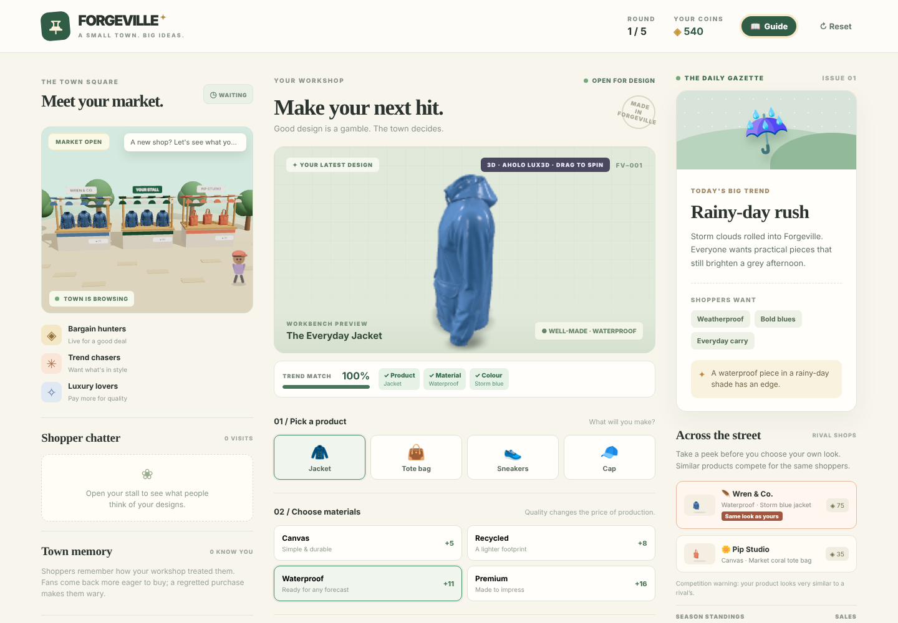
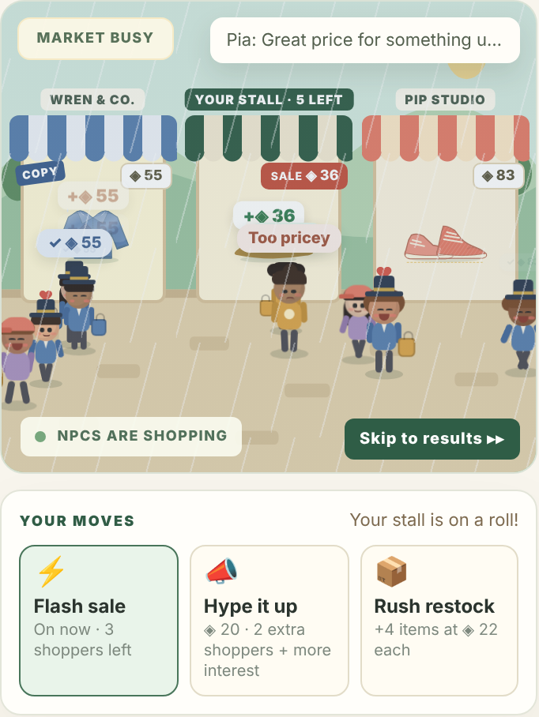
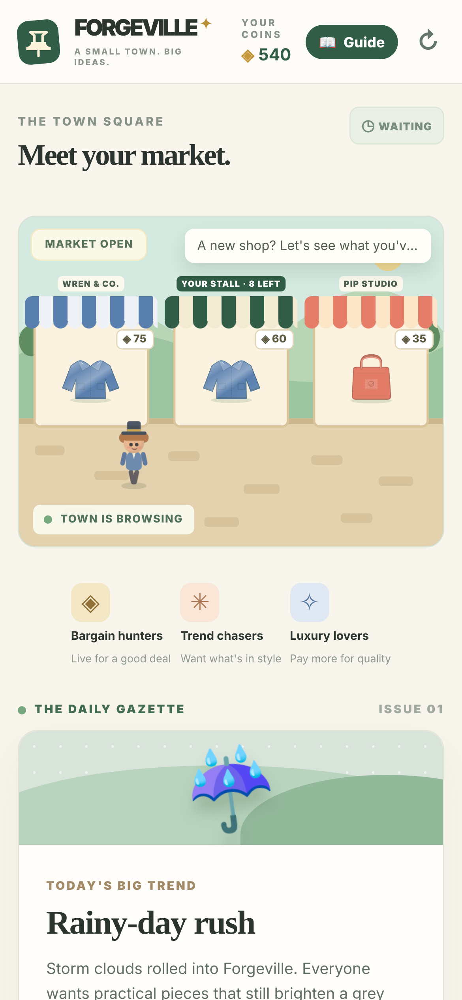
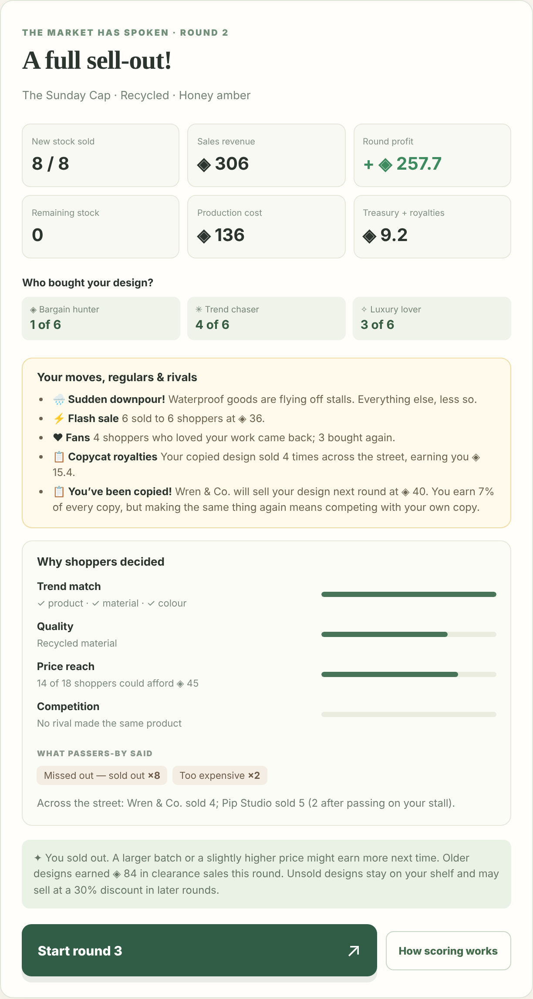
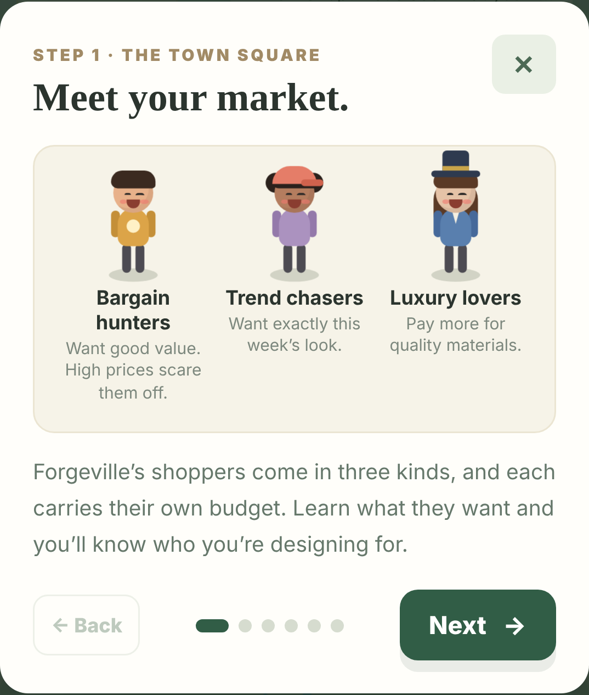

# Forgeville 3D: The Workshop Game

**A cozy workshop strategy game where every product in the town market is a 3D model generated with Aholo Lux3D.**

Forgeville is a browser strategy game about running a small workshop in a living town. Each market day the town wants something different. You design a product, set its price, pay for a batch, then open your stall and watch 18+ shoppers decide, one by one, whether you got it right. The products you make (a jacket, a tote bag, sneakers and a cap) are real 3D models generated with **[Aholo Lux3D](https://3d.aholo.ai)**.

▶ **Play:** [forgeville.myacxt.site](https://forgeville.myacxt.site)

Entry for the **Manycore Aholo Global 3D AI Hackathon** ("Play in 3D, Create with Aholo") · #Manycorehackathon · Solo developer: Mia ([@Mhiah](https://github.com/Mhiah))



---

## Built with Aholo Lux3D

The whole game is about the thing you make: its shape, its colour and its material. In flat 2D art, a waterproof jacket and a canvas jacket looked almost the same, and modelling every product in 3D by hand is out of reach for a solo developer. Aholo Lux3D closes that gap.

- **A live 3D workbench.** The product you're designing sits on your workbench as a real 3D model. It turns slowly, and you can drag it to inspect it from any side before you spend coins on a batch.
- **Your choices repaint the model.** Pick a colour and the Lux3D model is recoloured on the spot. Pick a material and its surface changes: canvas is matte, recycled is soft, waterproof is glossy and premium has a soft sheen.
- **A market built from Lux3D assets.** When the game loads, every model is rendered in every town colour. Those renders are the goods on your stall, on your rivals' stalls and on the rival cards.
- **A 3D market square.** The town square opens in 3D (press **2D view** to switch back): three stalls with striped awnings, trees and a cobbled square, built in code with three.js. The Lux3D products sit on the counters in each shop's real colour and material, your stall updates as you design, and shoppers walk up in front of the stalls. Drag to look around.
- **Four models, 96 variations.** The jacket, tote bag, sneakers and cap were each generated once in a plain white finish, so the game can paint them in 6 colours × 4 materials.

### How the assets were made

| Step | What happens |
|---|---|
| 1. Prompt | Each product is described in plain white with no logos, so the game can tint it any colour. |
| 2. Aholo image | A reference image is generated in the Aholo3D workspace. |
| 3. Lux3D | Lux3D turns the image into a textured 3D model (Standard for the jacket and tote, Turbo for the sneakers and cap), exported as GLB. Textures are resized to 1024 px WebP so the game loads fast. |
| 4. In the game | `lux3d.js` loads the GLB on the workbench and sets each material's colour, roughness and metalness from the player's design. |
| 5. The market | A hidden viewer renders every product in every colour; those images become the stall and rival art. |

Prompts used:

- **Jacket:** a single zip-up rain jacket with hood down and two front pockets, standing upright, plain pure white fabric, no logos, no text, three-quarter front view, plain light grey background.
- **Tote bag:** a single canvas tote bag with two handles, standing upright, plain pure white fabric, no logos, no text, three-quarter front view, plain light grey background.
- **Sneakers:** a single low-top lace-up sneaker, plain pure white upper and sole, no logos, no text, three-quarter side view, plain light grey background.
- **Cap:** a single baseball cap with a curved brim, plain pure white fabric, no logos, no text, three-quarter front view, plain light grey background.

## The idea

Most tycoon games turn customers into a number. In Forgeville, every customer is a person.

The town has **24 named townsfolk** in three kinds (bargain hunters, trend chasers and luxury lovers), each with their own budget and taste. They walk up to your stall, buy or tell you why they didn't ("too pricey", "not my style"), and **they remember you**. Shoppers who loved a purchase come back as fans. A regretted buy makes them wary. Rivals across the street compete for the same shoppers, and when you sell a hit, **they copy it**.

The core tension: **you can't design for everybody.**

<p align="center">
  
  
</p>

## How to play

1. **Meet your market.** Learn what each kind of shopper wants and can afford.
2. **Read the trend.** The Daily Gazette announces what's hot this round: products, materials and colours. A live trend-match meter scores your design.
3. **Design and produce.** Choose a jacket, tote, sneakers or cap; a material (canvas, recycled, waterproof, premium); a colour; a price; and a batch size. You pay for the whole batch up front.
4. **Open your stall.** Shoppers walk through the town square and decide. While they arrive you can make **three moves** (once each per round):
   - ⚡ **Flash sale:** 20% off for the next 6 shoppers.
   - 📣 **Hype it up:** spend ◈ 20 to draw 2 extra shoppers and raise interest.
   - 📦 **Rush restock:** make 4 more items mid-round at a premium.
5. **React to the town.** Each round brings one surprise event: a downpour, a rival's price cut, a tour bus, a style influencer or a heatwave.
6. **Upgrade your workshop.** Between rounds, spend profit on a master loom, a bigger stall, a painted sign, a trend scout or a storage room.
7. **Win the season.** Five market days, up to **3 stars**: top the season standings, reach ◈ 2,000 workshop value and win 12 loyal fans. Rivals you out-sell fight back with lower prices and more regulars.

A six-step illustrated **Guide** is in the top-right corner of the game.

## What makes it different

| Feature | What it does |
|---|---|
| **Shoppers who think out loud** | Before deciding, each shopper weighs your offer in a thought bubble: *“◈60? My budget’s ◈45…”*, *“Loved my last one here…”*, *“Wren has one for ◈55…”* |
| **Shoppers with memory** | 24 persistent townsfolk remember past purchases. Fans (♥) return keener to buy; regretted purchases make shoppers wary; price cuts get noticed. |
| **Copycat rivals** | Sell 60%+ of a batch and a rival copies your design next round, paying you a **7% design royalty** on every copy. Repeat yourself and you compete with your own copy. |
| **Rivals that fight back** | Out-sell a rival and next round they undercut your prices and pull in extra regulars. |
| **Workshop upgrades** | Five one-time upgrades turn profit into long-term strategy. |
| **Live market moves** | Flash sales, hype and restocks let you respond while shoppers are deciding, guided by hints based on what they're saying. |
| **Town events** | One surprise per round changes demand partway through a market day. |
| **Readable results** | Every round explains *why*: trend match, quality, price reach, competition, what passers-by said, how each move performed and who crossed the street. |
| **A living town** | Animated shoppers with faces, hairstyles and moods; rival stalls; season standings; town memory panel. |

<p align="center">
  
  
</p>

## How AI was used

Mia directed the design, gameplay and testing. AI was used in three ways:

- **Building the game:** the first playable prototype (economy, product designer, three shopper types) and every later system (the animated town, shopper memory, copycat rivals, live moves, town events, the guide) were written with AI coding assistants from Mia's direction and feedback.
- **The shopper model:** shoppers are "AI-style" agents. Each one scores a product on price against their budget, trend fit, material quality, competition and their memory of your stall, then decides and explains the decision in their own words.
- **Testing:** AI-driven browser playtests played full five-round seasons on desktop and phone screen sizes after every change, checking the economy, the visitor counts and console errors, and capturing screenshots for review.
- **3D products:** every product is a 3D model generated with Aholo Lux3D. Characters and town scenery are drawn in code (SVG and CSS).

## What's next

1. **Make your own product.** Players type a product idea, Lux3D generates it in the game, and every workshop sells something no one else has.
2. **A 3D town.** Lux3D shopkeepers and townsfolk, and a full 3D town square built with Aholo SpatialGen.
3. **Polish the core loop.** Sound and music, saved progress, a guided first round and balancing passes on prices and shopper budgets.
4. **Deepen the town.** More products and materials, seasons across a year, more events, and townsfolk who recommend your stall to their friends.
5. **Talking townsfolk.** Optional LLM-written dialogue on top of the shopper model, so regulars chat about your designs and gossip about rivals.

## Run it locally

No build step and no install. The 3D viewer ([`<model-viewer>`](https://modelviewer.dev), open source) is included in `vendor/`. Serve the folder with any static server so the browser can load the 3D models:

```bash
git clone https://github.com/Mhiah/Forgeville.git
cd Forgeville
python3 -m http.server 8000   # then open http://localhost:8000
```

| File | Purpose |
|---|---|
| `index.html` | Layout, town scene and panels |
| `style.css` | Styling, characters and animation |
| `game.js` | Economy, shopper model, town memory, rivals, events, animation and guide |
| `lux3d.js` | Loads the Aholo Lux3D models, repaints them from the player's design and renders the stall art |
| `assets/models/` | The four product models generated with Aholo Lux3D (`.glb`) |
| `vendor/model-viewer.min.js` | Google's open-source 3D viewer |
| `market3d.js` | The 3D market square (three.js): stalls, ground and trees built in code, with the Lux3D products on the counters |
| `vendor/three/` | three.js (open source, MIT licence) |
| `forgeville-playable.html` | Older single-file 2D build (no 3D models) |
| `tools/build_single_file.py` | Rebuilds the single-file version: `python3 tools/build_single_file.py` |
| `vercel.json`, `netlify.toml` | Hosting config: a static site with no build step, deployed from `main` |

The economy is simulated in the browser: coins, design cards, royalties and the town treasury are game mechanics. Generated 3D assets are subject to Aholo's terms of use.

---

© Mia (Mhiah). All rights reserved.
