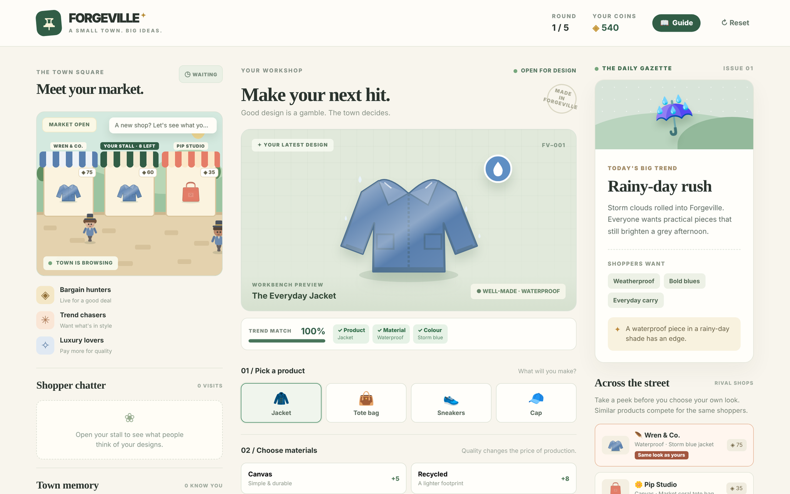

# Forgeville — The Workshop Game

**Design, price and sell to a town of NPC shoppers who remember you, in a cozy workshop strategy game.**

Forgeville is a browser strategy game about running a small workshop in a living town. Each market day the town wants something different. You design a product, set its price, pay for a batch, then open your stall and watch 18+ shoppers decide, one by one, whether you got it right.

▶ **Play:** [mhiah.github.io/Forgeville](https://mhiah.github.io/Forgeville/) · or open `forgeville-playable.html` in any browser (single file, works offline)

Entry for the **Loadout AI Game Competition** · Stage: **Playable demo** · Solo developer: Mia ([@Mhiah](https://github.com/Mhiah))



---

## The idea

Most tycoon games turn customers into a number. In Forgeville, every customer is a person.

The town has **24 named townsfolk** in three kinds (bargain hunters, trend chasers and luxury lovers), each with their own budget and taste. They walk up to your stall, buy or tell you why they didn't ("too pricey", "not my style"), and **they remember you**. Shoppers who loved a purchase come back as fans. A regretted buy makes them wary. Rivals across the street compete for the same shoppers, and when you sell a hit, **they copy it**.

The core tension: **you can't design for everybody.**

<p align="center">
  
  
</p>

## How to play

1. **Meet your market.** Learn what each kind of shopper wants and can afford.
2. **Read the trend.** The Daily Gazette announces what's hot this round: products, materials and colours. A live trend-match meter scores your design.
3. **Design and produce.** Choose a jacket, tote, sneakers or cap; a material (canvas, recycled, waterproof, premium); a colour; a price; and a batch size. You pay for the whole batch up front.
4. **Open your stall.** Shoppers walk through the town square and decide. While they arrive you can make **three moves** (once each per round):
   - ⚡ **Flash sale:** 20% off for the next 6 shoppers.
   - 📣 **Hype it up:** spend ◈ 20 to draw 2 extra shoppers and raise interest.
   - 📦 **Rush restock:** make 4 more items mid-round at a premium.
5. **React to the town.** Each round brings one surprise event: a downpour, a rival's price cut, a tour bus, a style influencer or a heatwave.
6. **Win the season.** Five market days. Unsold stock carries over at a discount. Beat Wren & Co. and Pip Studio in the season standings.

A six-step illustrated **Guide** is in the top-right corner of the game.

## What makes it different

| Feature | What it does |
|---|---|
| **Shoppers with memory** | 24 persistent townsfolk remember past purchases. Fans (♥) return keener to buy; regretted purchases make shoppers wary; price cuts get noticed. |
| **Copycat rivals** | Sell 60%+ of a batch and a rival copies your design next round, paying you a **7% design royalty** on every copy. Repeat yourself and you compete with your own copy. |
| **Live market moves** | Flash sales, hype and restocks let you respond while shoppers are deciding, guided by hints based on what they're saying. |
| **Town events** | One surprise per round changes demand partway through a market day. |
| **Readable results** | Every round explains *why*: trend match, quality, price reach, competition, what passers-by said, how each move performed and who crossed the street. |
| **A living town** | Animated shoppers with faces, hairstyles and moods; rival stalls; season standings; town memory panel. |

<p align="center">
  
  
</p>

## How AI was used

AI coding assistants were used throughout development, with Mia directing the design, gameplay decisions and testing:

- **Building the game:** the first playable prototype (economy, product designer, three shopper types) and every later system (the animated town, shopper memory, copycat rivals, live moves, town events, the guide) were written with AI coding assistants from Mia's direction and feedback.
- **The shopper model:** shoppers are "AI-style" agents. Each one scores a product on price against their budget, trend fit, material quality, competition and their memory of your stall, then decides and explains the decision in their own words.
- **Testing:** AI-driven browser playtests played full five-round seasons on desktop and phone screen sizes after every change, checking the economy, the visitor counts and console errors, and capturing screenshots for review.
- **Art:** all characters, products and town scenery are drawn in code (SVG and CSS), so there is no generated or stock imagery.

## Development plan

Forgeville is a playable demo. The plan, in order:

1. **Polish the core loop.** Sound and music, saved progress, a guided first round, balancing passes on prices and shopper budgets, accessibility (keyboard play, reduced motion is already supported).
2. **Deepen the town.** More products and materials, seasons that change across a year, workshop upgrades and staff, more events, and townsfolk with relationships (friends recommend your stall to each other).
3. **Talking townsfolk.** Optional LLM-written dialogue on top of the deterministic shopper model, so regulars chat about your designs, gossip about rivals and react to town events in their own voice, without changing the fairness of the simulation.
4. **Competitive seasons.** Asynchronous multiplayer: players' workshops share one town and one set of shoppers, with weekly season leaderboards.
5. **Creator layer.** Player designs become collectible **design cards**. The copycat royalty already in the game becomes a real remix royalty, optionally onchain on Solana, with design challenges funded by the town treasury.
6. **Launch.** Mobile-friendly web release first, then wider distribution with Loadout.

## Run it locally

No build step and no dependencies.

```bash
git clone https://github.com/Mhiah/Forgeville.git
cd Forgeville
open index.html          # or double-click forgeville-playable.html
```

| File | Purpose |
|---|---|
| `index.html` | Layout, town scene and panels |
| `style.css` | Styling, characters and animation |
| `game.js` | Economy, shopper model, town memory, rivals, events, animation and guide |
| `forgeville-playable.html` | Single-file build of the three files above |
| `tools/build_single_file.py` | Rebuilds the single-file version: `python3 tools/build_single_file.py` |
| `.github/workflows/pages.yml` | Publishes the game to GitHub Pages on every push to `main` |

The economy is simulated in the browser: coins, design cards, royalties and the town treasury are game mechanics. No wallet, token or NFT is involved in this version.

---

© Mia (Mhiah). All rights reserved.
